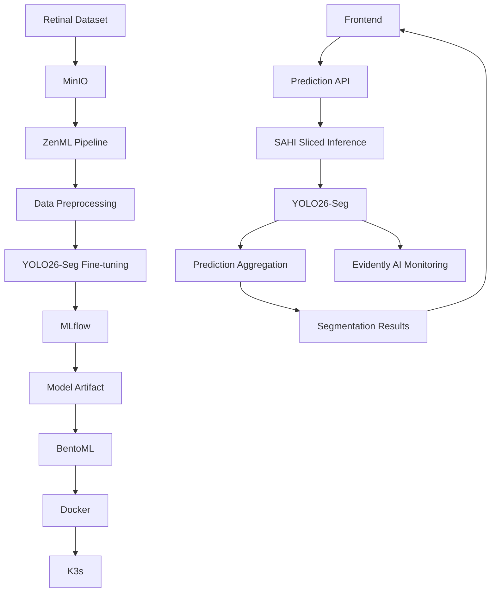

# RetinaOps
### End-to-End MLOps Platform for Retinal Lesion Segmentation

RetinaOps is an end-to-end MLOps platform designed to automate the training, fine-tuning, deployment, serving, and monitoring of a retinal lesion segmentation model using **YOLO26-Seg** and **SAHI**.

The platform integrates data management, experiment tracking, model serving, Kubernetes deployment, and production monitoring into a unified ML lifecycle.

## Application Preview

### Image Analysis


### Segmentation Results


## Architecture



## Technology Stack

| Component | Technology |
|---|---|
| Computer Vision | YOLO26-Seg, SAHI |
| Pipeline Orchestration | ZenML |
| Experiment Tracking | MLflow |
| Object Storage | MinIO |
| Model Serving | BentoML |
| Containerization | Docker |
| Orchestration | K3s |
| Monitoring | Evidently AI |
| CI/CD | GitHub Actions |

## Machine Learning Lifecycle

**1. Data Ingestion**

Retinal images and annotations are stored in MinIO for centralized dataset management.

**2. Data Preprocessing**

ZenML orchestrates preprocessing, dataset validation, and preparation of training, validation, and testing datasets.

**3. Model Fine-tuning**

A pretrained YOLO26-Seg model is fine-tuned on annotated retinal images to detect and segment retinal lesions.

**4. Experiment Tracking**

MLflow tracks training parameters, evaluation metrics, experiments, and model artifacts.

**5. Model Deployment**

The selected model artifact is packaged with BentoML, containerized using Docker, and deployed to K3s.

**6. Model Inference**

SAHI divides high-resolution retinal images into overlapping tiles. YOLO26-Seg processes each tile, and predictions are mapped back and combined to generate the final segmentation results.

**7. Model Monitoring**

Evidently AI processes prediction data in batches to monitor data quality and changes in prediction behavior.

## Inference Workflow

```text
Frontend
   |
   v
BentoML Prediction API
   |
   v
SAHI - Image Slicing
   |
   v
YOLO26-Seg Inference
   |
   v
Prediction Aggregation
   |
   v
Segmentation Results
   |
   v
Frontend Visualization
```

## CI/CD and Infrastructure

GitHub Actions automates application validation and image build workflows.

Docker packages the serving application and its dependencies, while K3s orchestrates the deployed services.

## Key Features

- Automated ML lifecycle orchestration with ZenML.
- YOLO26-Seg fine-tuning for retinal lesion segmentation.
- SAHI-based sliced inference for high-resolution images.
- Experiment tracking and artifact management with MLflow.
- Model serving with BentoML.
- Containerized deployment on K3s.
- Prediction monitoring with Evidently AI.
- Interactive frontend for image upload and segmentation visualization.

## Disclaimer

RetinaOps is an AI engineering and MLOps project. Its predictions are intended for research and educational purposes and are not a substitute for professional medical diagnosis.

---

**RetinaOps**  
End-to-End MLOps for Retinal Image Segmentation.
