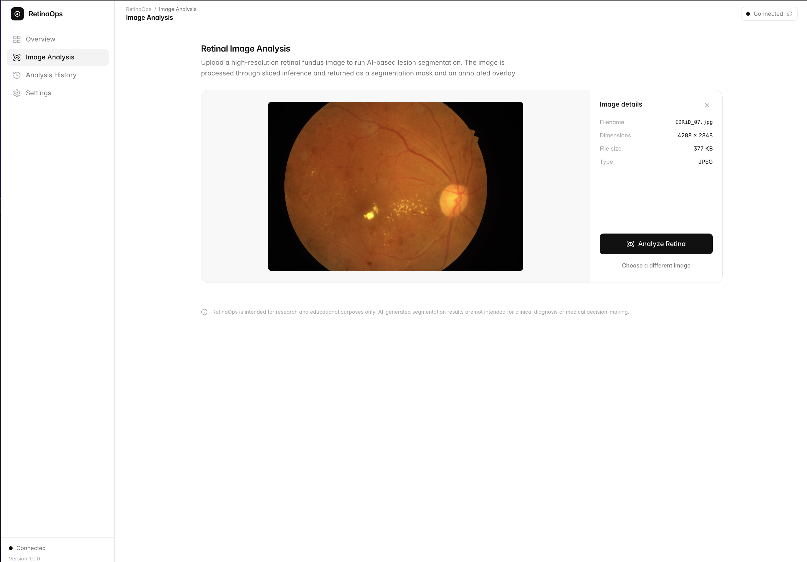
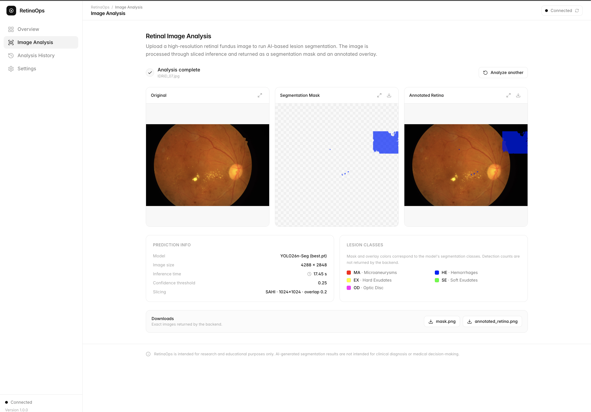
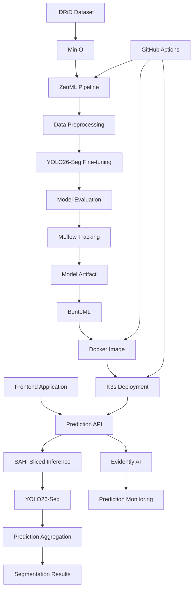

# RetinaOps — End-to-End MLOps Platform for Retinal Lesion Segmentation

## Project Objective

The primary objective of RetinaOps is to design and implement an end-to-end MLOps platform that automates the lifecycle of a computer vision model, from dataset ingestion and model training to deployment, inference, and continuous monitoring.

**The focus is the MLOps infrastructure and automation, not developing a state-of-the-art medical AI model or creating a new dataset.**

To demonstrate the platform, an existing public retinal fundus image dataset is used, and YOLO26-Seg serves as the computer vision model running through the pipeline.

The project demonstrates how ML engineering tools and DevOps practices can work together to manage, deploy, and monitor a segmentation model in a Kubernetes environment.

## Dataset

This project uses the **Indian Diabetic Retinopathy Image Dataset (IDRiD)**.

- **Source:** [Zenodo — IDRiD Dataset](https://zenodo.org/records/17219542)
- **Dataset:** Original retinal fundus images and ground-truth segmentation masks.
- **Usage:** Dataset ingestion, preprocessing, fine-tuning, evaluation, and model inference.
- **Storage:** MinIO.

The dataset is publicly available and is not created or collected as part of this project.

## Application Preview





## Architecture



## Technology Stack

| Component | Technology | Purpose |
|---|---|---|
| Segmentation model | YOLO26-Seg | Retinal lesion segmentation |
| Sliced inference | SAHI | Inference on image slices |
| Dataset storage | MinIO | Store images, masks, and artifacts |
| Pipeline orchestration | ZenML | Automate ML lifecycle |
| Experiment tracking | MLflow | Track experiments and metrics |
| Model serving | BentoML | Package and expose model API |
| Containerization | Docker | Build deployment images |
| Orchestration | K3s | Deploy and manage services |
| Monitoring | Evidently AI | Monitor prediction data |
| CI/CD | GitHub Actions | Automate pipeline and deployment workflows |

## MLOps Lifecycle

### 1. Data Ingestion

The IDRiD dataset is downloaded and ingested into MinIO.

The dataset contains retinal fundus images and their corresponding ground-truth segmentation masks.

### 2. Data Preprocessing

A ZenML pipeline prepares the dataset for model training:

- Load images and segmentation masks.
- Validate image and mask pairs.
- Convert annotations into the required YOLO segmentation format.
- Split data into training and validation sets.
- Store processed datasets for reproducibility.

### 3. Model Fine-tuning

YOLO26-Seg is fine-tuned using the prepared IDRiD dataset.

The model learns to identify and segment retinal lesions from fundus images.

Model training and evaluation are executed as part of the ZenML pipeline.

### 4. Experiment Tracking

MLflow tracks model experiments, including:

- Training parameters.
- Evaluation metrics.
- Model versions.
- Training artifacts.

This provides visibility into experiments and makes model versions easier to compare.

### 5. Model Deployment

The selected model is packaged and served using BentoML.

The application is containerized with Docker and deployed to a K3s cluster.

K3s manages the model-serving workload and exposes the prediction API to the frontend.

### 6. Inference with SAHI

SAHI (Slicing Aided Hyper Inference) is used during inference.

It divides large retinal images into smaller overlapping slices, runs the segmentation model on each slice, and combines the resulting predictions.

This helps detect smaller objects that may be difficult to identify when processing an entire high-resolution image at once.

### 7. Frontend Application

A frontend application allows users to:

- Upload retinal fundus images.
- Submit images to the deployed prediction API.
- View predicted lesion classes and confidence scores.
- Visualize segmentation masks and detection results.

### 8. Model Monitoring

Evidently AI receives prediction data from the deployed service.

It processes prediction batches to monitor data quality and changes in incoming data.

The monitoring component helps observe the behavior of the deployed model over time.

## Inference Workflow

```text
User uploads retinal image
          |
          v
     Frontend
          |
          v
   BentoML Prediction API
          |
          v
    SAHI Slicing
          |
          v
     YOLO26-Seg
          |
          v
  Slice Predictions
          |
          v
 Prediction Aggregation
          |
          v
 Segmentation Visualization
          |
          v
  Frontend Results
```

## CI/CD and Infrastructure

GitHub Actions is used to automate selected pipeline and deployment workflows.

The deployment architecture uses Docker containers running on K3s, providing a Kubernetes-based environment for model serving and supporting services.

## Key Project Focus

This project demonstrates practical implementation of:

- End-to-end ML lifecycle automation.
- Reproducible data and training pipelines.
- Experiment tracking and model versioning.
- Model packaging and API serving.
- Containerization and Kubernetes deployment.
- Sliced inference for high-resolution images.
- Prediction monitoring.

## Scope and Disclaimer

RetinaOps is an MLOps engineering project. The IDRiD dataset and YOLO26-Seg model are used to demonstrate the platform's capabilities.

The project does not aim to establish clinical performance or provide medical diagnoses. Its outputs are intended for educational and engineering purposes.

---

**RetinaOps — Building an End-to-End MLOps Platform for Computer Vision.**
